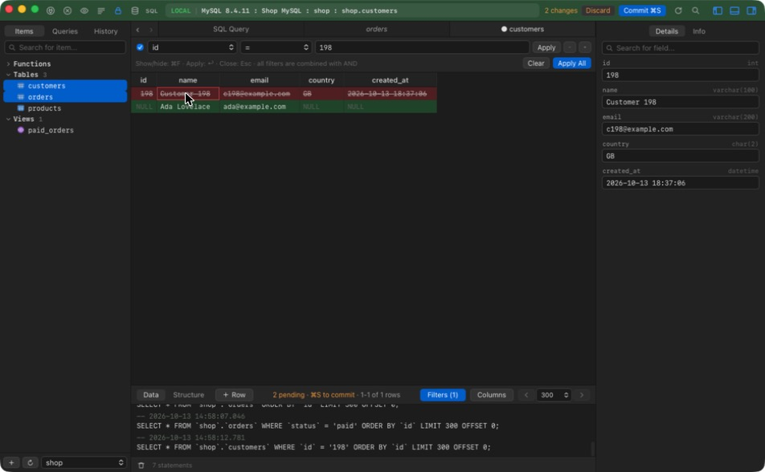
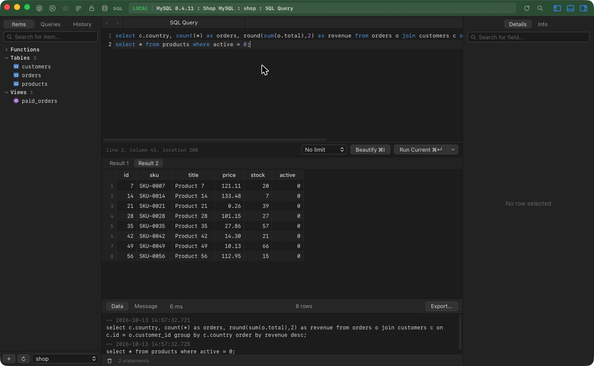

# Querybird

A free, open-source database client for **PostgreSQL** and **MySQL**, built with Rust and Tauri.
Its interface follows the native, keyboard-first feel of TablePlus — but there is no license key,
no trial and no account. Ever.

Runs on macOS, Windows and Linux.




## Download

Get the latest installer from the **[Releases](../../releases)** page:

| Platform | File |
| --- | --- |
| macOS (Apple Silicon + Intel) | `Querybird_x.y.z_universal.dmg` |
| Windows 10/11 | `Querybird_x.y.z_x64-setup.exe` (or `.msi`) |
| Linux | `.deb` or `.AppImage` |

> macOS: until the app is notarized, the first launch may say Apple can't verify it. Right-click Querybird in
> Applications → **Open**, or run `xattr -dr com.apple.quarantine /Applications/Querybird.app`.

Releases are built by GitHub Actions on each `v*` tag (`.github/workflows/release.yml`).

## Features

**Connections**
- Connection list with search, driver badges, tags (local / development / testing / staging / production) and status colors
- Create, edit, duplicate, delete; import from a `postgresql://` or `mysql://` URL
- Passwords stored in the OS keychain (macOS Keychain, Windows Credential Manager, Secret Service on Linux) — or asked every time
- SSL modes: disable / preferred / required
- **SSH tunnels** (password or private key, host key remembered on first connect)
- Bootstrap commands run after connecting; connection groups; copy connection as URL
- **Backup / restore** via pg_dump, pg_restore, psql, mysqldump and mysql
- One window per connection; the toolbar is tinted with the connection's status color

**Browsing & editing**
- Sidebar with tables, views and functions, search, schema/database switcher
- Virtualized data grid: sorting, column resizing (double-click edge to auto-fit), keyboard navigation, multi-row selection, copy as TSV / JSON / SQL INSERT
- Foreign-key arrows jump to the referenced row
- Filters (`=`, `<>`, `IN`, `BETWEEN`, `LIKE`, contains, begins/ends with, `IS NULL`, …) plus raw SQL `WHERE`
- Inline editing, insert / duplicate / delete rows — changes stay **pending** (highlighted) until you commit with ⌘S, and are applied in a single transaction
- Preview the generated SQL before committing; discard at any time
- Undo / redo of pending edits, paste rows from the clipboard, duplicate rows, set NULL / EMPTY / DEFAULT
- Quick Look editor for long values and JSON, quick filters, copy rows as CSV / JSON / Markdown / SQL
- Structure editor: rename, retype, nullability, defaults, comments, add/drop columns and indexes — review the ALTERs, then commit
- Import from CSV (with column mapping) or SQL dump; export tables to CSV / JSON / SQL
- Item overview, process list with kill, user list, search across every table
- Paging with stable ordering (primary key), hide/show columns
- Details panel shows the focused row as an editable form, or table info (size, rows, engine…)

**SQL editor**
- Syntax highlighting, autocompletion of keywords and table names
- Run current statement (⌘↵) or all (⌘⇧↵), automatic `LIMIT`, multiple result sets
- Beautify (⌘I), saved queries (⌘S), query history
- Export results to CSV, JSON or SQL

**Ask AI (natural language → SQL)**
- The **AI** button next to **SQL** (⌘J) opens a tab where you ask questions in plain language
- Claude (Anthropic API key, or "Sign in with Anthropic" via the official `ant` CLI's OAuth) or OpenAI (API key)
- Every answer shows the generated SQL, the model's explanation, the model used, timings and the result grid; the SQL is also written to the console log and history
- Read-only SQL can run automatically; anything that changes data always asks first. "Fix with AI" retries with the database error
- Only your question and the schema (names, types, keys) are sent — never row data. "What was sent" shows the exact context

**Safety**
- Safe mode (lock icon): every write needs confirmation. On by default for connections tagged `production`
- Console log of every statement Querybird runs

## Keyboard shortcuts

| Action | macOS | Windows / Linux |
| --- | --- | --- |
| Open anything (tables, views, saved queries) | ⌘P | Ctrl+P |
| New SQL query tab | ⌘T | Ctrl+T |
| Close tab | ⌘W | Ctrl+W |
| Reload tab / sidebar items | ⌘R / ⌘⇧R | Ctrl+R / Ctrl+Shift+R |
| Commit pending changes (table) / save query (editor) | ⌘S | Ctrl+S |
| Toggle filters | ⌘F | Ctrl+F |
| Insert row | ⌘I | Ctrl+I |
| Delete selected rows | ⌘⌫ | Ctrl+Backspace / Delete |
| Run current / all statements | ⌘↵ / ⌘⇧↵ | Ctrl+Enter / Ctrl+Shift+Enter |
| Beautify SQL | ⌘I (in editor) | Ctrl+I |
| Previous / next tab | ⌘⇧[ / ⌘⇧] | Ctrl+Shift+[ / ] |
| Toggle sidebar / console / details | ⌘0 / ⌘⇧E / ⌘⇧. | Ctrl+0 / Ctrl+Shift+E / Ctrl+Shift+. |

## Building

Requirements: [Rust](https://rustup.rs) (stable), Node.js 20+, and the
[Tauri prerequisites](https://tauri.app/start/prerequisites/) for your OS.
On Linux you also need `libdbus-1-dev` (keychain access) — e.g.
`sudo apt install libwebkit2gtk-4.1-dev libdbus-1-dev build-essential libssl-dev librsvg2-dev`.

```bash
npm install
npm run tauri dev      # run in development
npm run tauri build    # produce installers in src-tauri/target/release/bundle
```

## Testing

```bash
npm test                               # frontend unit tests (SQL splitting, edits, export)
cd src-tauri && cargo test             # SQL generation unit tests

# end-to-end against real databases (needs Docker)
scripts/test-dbs.sh
cd src-tauri && QUERYBIRD_LIVE_TESTS=1 cargo test --test live_db -- --test-threads=1
```

`scripts/test-dbs.sh` starts throwaway Postgres 16 (port 55432) and MySQL 8.4 (port 53306)
containers with a small `shop` sample database.

## Project layout

```
src-tauri/src/db/      Rust database layer: postgres (tokio-postgres), mysql (mysql_async), SQL generation
src-tauri/src/store.rs Saved connections + OS keychain
src-tauri/src/lib.rs   Tauri commands and window management
src/welcome/           Connection list, connection form, URL import
src/workspace/         Workspace window: toolbar, sidebar, tabs, data grid, SQL editor, details panel
src/lib/               Pure helpers (statement splitting, pending edits, export) with tests
```

See [PARITY.md](PARITY.md) for a feature-by-feature comparison with TablePlus.

## Roadmap

SQLite / Redis / other drivers, split panes, triggers editor, ER diagrams, passcode lock.

## License

MIT. Querybird is an independent project and is not affiliated with TablePlus.
